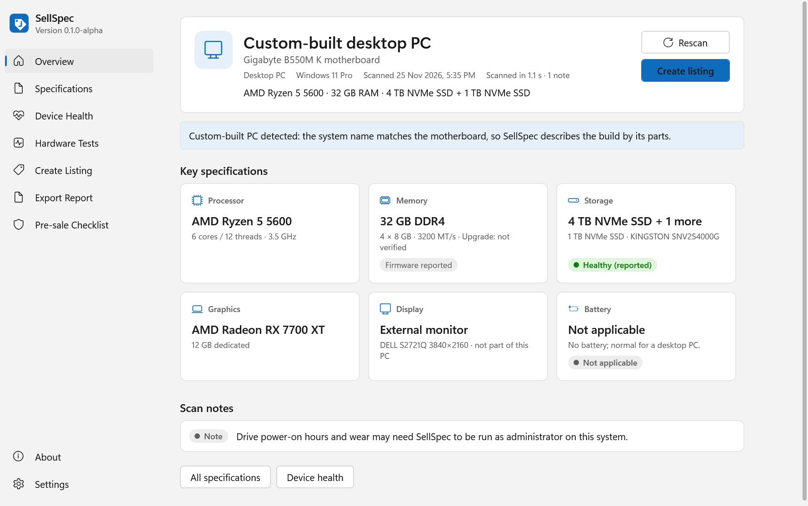
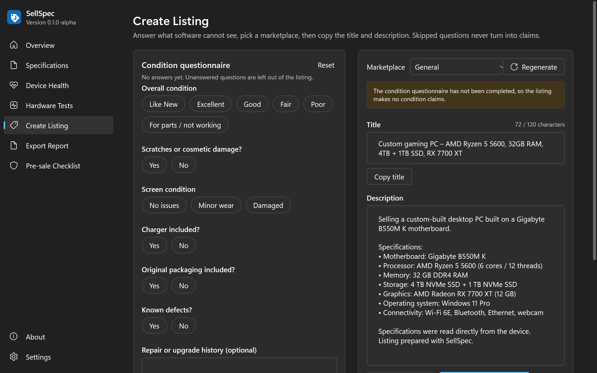
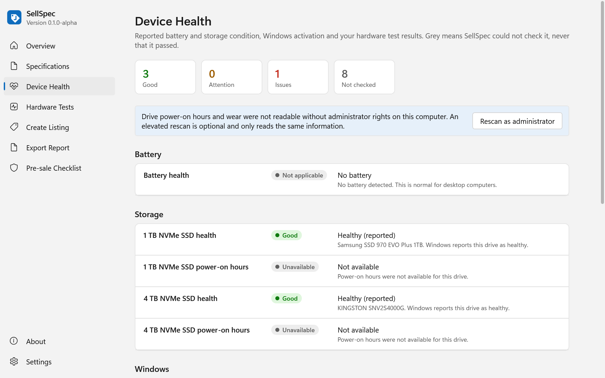

# SellSpec

[](https://github.com/SamJustSam-create/SellSpec/actions/workflows/ci.yml)
[](https://github.com/SamJustSam-create/SellSpec/releases)

**Scan it. List it. Sell it.**

SellSpec is a lightweight Windows desktop application that reads a computer's real specifications and health, asks the seller a few questions software cannot answer, and turns the result into a ready-to-paste marketplace listing and a shareable specification report.

It is built for people selling a laptop or desktop on Facebook Marketplace, eBay, Gumtree or similar, and for small refurbishers who want an honest, consistent description without digging through Windows settings.

| | |
|---|---|
| Platform | Windows 10 / 11, 64-bit |
| Stack | C# 14, .NET 10 (LTS), WPF, MVVM |
| Status | **0.1.1-alpha** – functional MVP; alpha pre-releases on GitHub |
| Network | None. No accounts, no telemetry, nothing leaves the device |
| Privileges | Standard user. Elevation is never required |

## What it does

1. **Scans the device automatically** on launch (about one second on the development machine): manufacturer and model, processor, memory, every storage drive, graphics adapters, displays, battery, connectivity, Windows edition, activation, TPM and Secure Boot.
2. **Labels every value with where it came from** – Detected, Firmware reported, Estimated, Seller provided, Unavailable or Not applicable – so neither the seller nor the buyer mistakes a guess for a fact.
3. **Shows device health**: reported battery health and cycle count, reported drive health and power-on hours, Windows activation, a basic Windows 11 readiness check, and the seller's own hardware test results. Grey always means "not checked", never "passed".
4. **Guides optional hardware tests**: on-screen keyboard, full-screen colour display test, speaker tone (left/right/both), microphone level meter, webcam check via the Windows Camera app, and connectivity confirmations. Results are recorded as seller-confirmed.
5. **Collects a short condition questionnaire** (overall grade, cosmetic damage, screen/keyboard/trackpad/hinge, battery concerns, charger and box, known defects, history, accessories, notes, asking price). Skipped questions never become claims.
6. **Generates marketplace listings** for Facebook Marketplace, eBay, Gumtree and a general template, with platform title limits, editable text, one-click copy of title and description, and plain-text export.
7. **Exports a specification report** as PNG, PDF, plain text or JSON, with a preview, SellSpec branding, the scan date and a plain-language disclaimer.
8. **Offers a pre-sale privacy checklist** that explains what to do before handing over the device and opens the relevant Windows Settings pages. It never deletes or resets anything.

Serial numbers, UUIDs, MAC and IP addresses, product keys and user names are never written to listings, reports, exports or logs. See [PRIVACY.md](PRIVACY.md).

## Screenshots

Captured with `--capture` from the application running on the development machine (a custom-built desktop), real data, light and dark themes.







Every page, the dark theme and the keyboard test window are in `docs/screenshots`; sample exports in all four formats and all four listing styles are in `docs/samples`.

## Getting SellSpec

Release artifacts are produced by `build\publish.ps1` into `artifacts\`:

| Artifact | Needs | Size (0.1.0-alpha) |
|---|---|---|
| `SellSpec-<version>-win-x64-portable.zip` | [.NET Desktop Runtime 10](https://dotnet.microsoft.com/download/dotnet/10.0) installed | 0.5 MB |
| `SellSpec-<version>-win-x64-singlefile.exe` | .NET Desktop Runtime 10 installed | 1.4 MB |
| `SellSpec-<version>-win-x64-selfcontained.exe` | Nothing | 60 MB (bundles the runtime; WPF cannot be trimmed) |

Measured sizes for the current build are listed in [TESTING.md](TESTING.md#performance-measurements). Checksums are in `artifacts\SHA256SUMS.txt`.

The binaries are **not code-signed** yet. Windows SmartScreen may warn on first launch. See [DEVELOPMENT.md](DEVELOPMENT.md#code-signing) for the signing procedure.

If the .NET Desktop Runtime 10 is missing, the framework-dependent builds show Windows' standard "You must install or update .NET" dialog with a download link and exit; the self-contained build runs regardless. (Verified on the development machine, which has no machine-wide runtime.)

### Portable mode

If a file named `portable.txt` sits next to `SellSpec.exe` (the zip includes one), settings and logs are kept in a `data` folder beside the executable. Otherwise they live in `%LOCALAPPDATA%\SellSpec`. Nothing else is written to the system; there is no installer and no registry footprint.

### Command-line switches

| Switch | Purpose |
|---|---|
| `--portable` | Force portable storage without a `portable.txt` file |
| `--demo` | Load a clearly labelled fictional laptop instead of scanning. A yellow banner is shown on every page. Useful for trying the laptop-only features on a desktop |
| `--capture <folder>` | Developer: scan, render every page (light and dark) and the keyboard test window to PNG, write sample exports in every format, then exit |
| `--elevated-rescan` | Used internally when the user chooses *Rescan as administrator* |

## Building from source

```powershell
. .\build\dotnet-env.ps1      # only needed if the .NET SDK is installed user-locally
dotnet build SellSpec.slnx
dotnet test SellSpec.slnx
dotnet run --project src\SellSpec.App
```

Full instructions, including publishing and code signing, are in [DEVELOPMENT.md](DEVELOPMENT.md).

## Project layout

```
SellSpec.slnx
Directory.Build.props          version, nullable, analysers
src/
  SellSpec.Core/               platform-independent model, normalisation, health rules,
                               listing generator, report writers (text/JSON/PDF), redaction
  SellSpec.Windows/            WMI/CIM, registry and Win32 providers; microphone meter
  SellSpec.App/                WPF shell, pages, themes, services (WPF-only code)
tests/
  SellSpec.Core.Tests/         unit + scenario tests with mocked hardware
  SellSpec.Windows.Tests/      helper tests + real-hardware integration tests
build/                         publish.ps1, checksums.ps1, make-icon.ps1, dotnet-env.ps1
docs/                          hardware detection methods, decisions, manual test checklist, screenshots
```

## Documentation

- [ARCHITECTURE.md](ARCHITECTURE.md) – components, data flow, design rules
- [docs/HARDWARE_DETECTION.md](docs/HARDWARE_DETECTION.md) – exactly how each value is read and where it can be wrong
- [DEVELOPMENT.md](DEVELOPMENT.md) – building, publishing, signing
- [TESTING.md](TESTING.md) – automated tests, performance measurements, manual checklist
- [SECURITY.md](SECURITY.md) and [PRIVACY.md](PRIVACY.md)
- [KNOWN_LIMITATIONS.md](KNOWN_LIMITATIONS.md) – what is partial, estimated or not implemented
- [ROADMAP.md](ROADMAP.md), [CHANGELOG.md](CHANGELOG.md), [CONTRIBUTING.md](CONTRIBUTING.md)
- [docs/DECISIONS.md](docs/DECISIONS.md) – architectural decision records
- [THIRD_PARTY_NOTICES.md](THIRD_PARTY_NOTICES.md)

## Licence

Copyright © 2026 SellSpec. All rights reserved. The licence for distribution has not been chosen yet; see [CONTRIBUTING.md](CONTRIBUTING.md).
